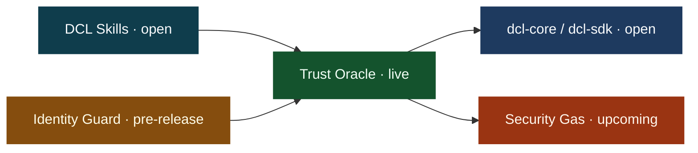

<div align="center">

# Fronesis Labs

**Infrastructure for verifiable AI agent decisions.**

*Don't trust the agent. Trust the proof.*

[](https://mcp.fronesislabs.com/mcp)
[](https://github.com/Fronesis-Labs/dcl-webhook)
[](#security-gas)
[](https://pypi.org/project/dcl-core/)
[](https://www.npmjs.com/package/@fronesis-labs/dcl-sdk)
[](https://github.com/Fronesis-Labs/dcl-core/blob/main/LICENSE)

[Connect](#connect) · [Map](#map) · [Catalog](#catalog) · [Evidence](#evidence) · [Catalog JSON](#catalog-json)

</div>

---

Verification belongs in the agent workflow, before an action is treated as a record. A verdict is a record you can check, and the check covers the record you were given, not the world behind it.

Try the same hash chain in the browser at [fronesislabs.com](https://fronesislabs.com/). Hashes are computed locally on that page. Nothing from the demo is uploaded.

## For agents

| | |
|---|---|
| **Entry point** | MCP server `com.fronesislabs/dcl-trust-oracle` at `https://mcp.fronesislabs.com/mcp` (Streamable HTTP) |
| **Tool discovery** | Call `tools/list`. Names, schemas, prices, and payment requirements come from that response, not from this page |
| **Payment** | x402, USDC on Base, per call. No API key, no account |
| **Unpaid call** | Returns Payment Required and no verdict |
| **Free path** | Local hash-chain verification with `dcl-core` or `@fronesis-labs/dcl-sdk`. No network call |
| **Machine-readable catalog** | [Catalog JSON](#catalog-json) below, snapshot dated `2026-10-17` |
| **Status values** | `live` · `open` · `reference` · `pre-release` · `upcoming` |

## Connect

Point an MCP client at the hosted Trust Oracle, then call `tools/list`.

```json
{
  "mcpServers": {
    "dcl-trust-oracle": {
      "url": "https://mcp.fronesislabs.com/mcp"
    }
  }
}
```

Paid tools settle in USDC on Base through [x402](https://x402.org). A client that can pay does so per call. A client that cannot receives Payment Required and no verdict.

> [!NOTE]
> The SDK's HTTP client and the MCP URL are different entrances. `@fronesis-labs/dcl-sdk` defaults its REST client to `https://x402.fronesislabs.com`. Local verification in that package calls neither host.

## Map



1. **DCL Skills** are free, instruction-only, and can run with no network call.
2. **Identity Guard** (pre-release) is a registry pre-filter in front of a protected route.
3. **Trust Oracle** evaluates the proposed output and appends an audit record.
4. **dcl-core / dcl-sdk** recompute that record locally.
5. **Security Gas** is the next step after an approved decision. It is not callable yet.

## Security Gas

**In progress · Release upcoming**

After an approved Oracle decision, Security Gas provides a signed, narrowly scoped Proof of Allowance (PoA) for a single action. A guarded contract verifies the allowance before the protected call.

Base is the intended first environment.

The execution result links back to the Oracle decision and payment evidence, completing the path from evaluation to execution.

Today, the live path reaches the Oracle verdict and audit record. The [Transparency Board](https://transparency.fronesislabs.com/) will present allowance and execution evidence as they become available.

## Catalog

| Component | Status | What you can do now | Canonical |
|---|---|---|---|
| **DCL Trust Oracle** | live | Evaluate a proposed agent output and receive an audit record | [dcl-webhook](https://github.com/Fronesis-Labs/dcl-webhook) |
| **Leibniz Layer** | open | Recompute a hash chain from records you already hold | [dcl-core](https://github.com/Fronesis-Labs/dcl-core) · [dcl-sdk](https://github.com/Fronesis-Labs/dcl-sdk) |
| **DCL Skills** | open | Run an instruction-only check with no network call | [dcl-skills](https://github.com/Fronesis-Labs/dcl-skills) |
| **DCL Audit Event** | open | Read one evaluation as a versioned event | [dcl-audit-event](https://github.com/Fronesis-Labs/dcl-audit-event) |
| **Web2 Guard** | open | Gate one HTTP call on an exact `COMMIT` | [dcl-core](https://github.com/Fronesis-Labs/dcl-core#web2-http-side-effect) |
| **Identity Guard** | pre-release | Pre-filter a route on TRC-8004 registry signals | [x402-identity-guard](https://github.com/Fronesis-Labs/x402-identity-guard) |
| **Security Gas** | upcoming | Nothing yet, not callable | [This profile](#security-gas) |
| **LangChain adapter** | reference | Wire LangChain to the Oracle | [dcl-langchain](https://github.com/Fronesis-Labs/dcl-langchain) |
| **paymcp** | open | Meter an MCP tool through a payment provider | [paymcp](https://github.com/Fronesis-Labs/paymcp) |
| **DCL Evaluator** | reference | Offline desktop audit trail | [dcl-evaluator](https://github.com/Fronesis-Labs/dcl-evaluator) |

Tool names and prices live on the server, so `tools/list` is the list to trust. The badges above read current PyPI and npm versions. This page does not pin a server build number.

<details>
<summary><b>DCL Trust Oracle</b> · live</summary>

<br>

Hosted MCP service (Streamable HTTP) for policy evaluation of a proposed agent output. The server stores hashes and decision metadata.

Same server, other directories:

- [MCP Registry `com.fronesislabs/dcl-trust-oracle`](https://registry.modelcontextprotocol.io/v0/servers?search=com.fronesislabs%2Fdcl-trust-oracle)
- [Smithery](https://smithery.ai/servers/fronesislabs/dcl-trust-oracle)
- [Glama](https://glama.ai/mcp/servers/Fronesis-Labs/dcl-webhook)

**Scope.** Connecting a client evaluates the calls that client makes. It does not intercept every action in an agent runtime, and it does not close every risk. An unpaid call returns no verdict.

</details>

<details>
<summary><b>Leibniz Layer</b> · open</summary>

<br>

Protocol and local verification behind DCL. [dcl-core](https://pypi.org/project/dcl-core/) (Python) and [@fronesis-labs/dcl-sdk](https://www.npmjs.com/package/@fronesis-labs/dcl-sdk) (TypeScript) recompute each record's hash and the links between records. Both are Apache-2.0. Verification of a chain you already hold is free on purpose: the paid step is evaluation, not the check.

Project site: [leibniz.fronesislabs.com](https://leibniz.fronesislabs.com/).

**Scope.** A clean local check means the supplied records still match their stored hashes. It does not, by itself, prove that an upstream verdict was the right verdict, or that an identifier is a verified identity.

</details>

<details>
<summary><b>DCL Skills</b> · open</summary>

<br>

Instruction-only checklists for jailbreak and prompt-injection defense, PII and secret handling, hallucination and drift checks, plus a DeFi-oriented set. They run inside the agent with no Fronesis endpoint. Most skills can optionally call the Trust Oracle when a sealed verdict is needed.

Canonical source: [dcl-skills](https://github.com/Fronesis-Labs/dcl-skills). Listings are also on [ClawHub](https://clawhub.ai/daririnch).

**Scope.** A skill checks the step it is written for. Installing the set does not wrap every later action in the runtime.

</details>

<details>
<summary><b>DCL Audit Event</b> · open</summary>

<br>

Versioned event schema for one policy-evaluation outcome. Event id, trace id, payment reference, and audit-chain hash stay distinct fields. Schema and implementation: [dcl-audit-event](https://github.com/Fronesis-Labs/dcl-audit-event).

**Scope.** `agent_id` is informational until a separate mechanism verifies it. A local audit hash is a hash of the record. It becomes a blockchain transaction only when a transaction actually exists.

</details>

<details>
<summary><b>Web2 Guard</b> · open</summary>

<br>

Client library path for an application that wants one HTTP side effect to wait for an Oracle decision. `DCLGuard.post()` fails closed unless it receives an exact `COMMIT` whose request digest matches and whose response is acceptable. Documented observations, including a paid `COMMIT` and a `NO_COMMIT` that did not send the target request, are in the [dcl-core README](https://github.com/Fronesis-Labs/dcl-core#web2-http-side-effect).

**Scope.** Enforcement applies to this call path. Another HTTP client in the same application bypasses it.

</details>

<details>
<summary><b>Identity Guard</b> · pre-release</summary>

<br>

Open-source pre-filter on TRC-8004: registration, reputation, and validation signals, then `ALLOW`, `FLAG`, or `DENY`. Trust Oracle can evaluate the proposed action afterward. Repository: [x402-identity-guard](https://github.com/Fronesis-Labs/x402-identity-guard).

`main` is the development line for `v0.3.0`. No stable tag is published. Evidence so far is a real agent on Shasta testnet, which is a separate milestone from mainnet.

**Scope.** The registry check compares registry fields. It does not authenticate the caller. The declared `agent_id` is not yet cryptographically bound to the x402 payer. Binding the caller, payer, or a delegation is an `identity_binding` callback the integrator supplies.

</details>

<details>
<summary><b>Also published</b></summary>

<br>

- [dcl-langchain](https://github.com/Fronesis-Labs/dcl-langchain): reference adapter from LangChain to Trust Oracle.
- [paymcp](https://github.com/Fronesis-Labs/paymcp): provider-agnostic payment layer for MCP tools. The hosted Oracle uses it for x402 on the MCP side.
- [dcl-evaluator](https://github.com/Fronesis-Labs/dcl-evaluator): original desktop, offline-capable audit trail. Public, and not the primary path for agents, who use the hosted Oracle.
- [awesome-mcp-servers](https://github.com/Fronesis-Labs/awesome-mcp-servers): a collected index of MCP servers, separate from the products above.
- [dcl-transparency](https://github.com/Fronesis-Labs/dcl-transparency): source of the public board.

</details>

## Evidence

The [DCL Transparency Board](https://transparency.fronesislabs.com/) publishes exported DCL records and the payment data attached to them. It shows what was exported. It does not verify those records itself.

- Exports are periodic.
- Coverage differs by record: a row may have no payment transaction, network, event id, or trace id.
- An audit-chain hash on the board is a hash, and a transaction reference is a transaction reference.
- Describe a record as public evidence only when it is actually on the board.

## Catalog JSON

Machine-readable snapshot of this page, dated `2026-10-17`. Tool names, schemas, and prices are intentionally absent: read them from live `tools/list`.

<details>
<summary><b>catalog.json</b></summary>

```json
{
  "schema_version": "1",
  "name": "Fronesis Labs",
  "updated": "2026-10-17",
  "site": "https://fronesislabs.com/",
  "contact": "partnership@fronesislabs.com",
  "mcp": {
    "id": "com.fronesislabs/dcl-trust-oracle",
    "url": "https://mcp.fronesislabs.com/mcp",
    "transport": "streamable-http",
    "tools": "live:tools/list",
    "payment": {
      "protocol": "x402",
      "asset": "USDC",
      "network": "base"
    }
  },
  "items": [
    {
      "id": "dcl-trust-oracle",
      "status": "live",
      "kind": "mcp-server",
      "summary": "Evaluate a proposed agent output and append an audit record.",
      "repo": "https://github.com/Fronesis-Labs/dcl-webhook",
      "endpoint": "https://mcp.fronesislabs.com/mcp",
      "directories": [
        "https://registry.modelcontextprotocol.io/v0/servers?search=com.fronesislabs%2Fdcl-trust-oracle",
        "https://smithery.ai/servers/fronesislabs/dcl-trust-oracle",
        "https://glama.ai/mcp/servers/Fronesis-Labs/dcl-webhook"
      ],
      "limits": [
        "Covers calls this client makes.",
        "An unpaid call returns no verdict."
      ]
    },
    {
      "id": "leibniz-layer",
      "status": "open",
      "kind": "protocol",
      "summary": "Local hash-chain verification of records you already hold.",
      "repos": [
        "https://github.com/Fronesis-Labs/dcl-core",
        "https://github.com/Fronesis-Labs/dcl-sdk"
      ],
      "packages": [
        "https://pypi.org/project/dcl-core/",
        "https://www.npmjs.com/package/@fronesis-labs/dcl-sdk"
      ],
      "limits": [
        "A clean check matches supplied records to their stored hashes.",
        "It does not prove the upstream verdict was correct.",
        "It does not prove an identifier is a verified identity."
      ]
    },
    {
      "id": "dcl-skills",
      "status": "open",
      "kind": "agent-skills",
      "summary": "Instruction-only checks, with an optional live Oracle call.",
      "repo": "https://github.com/Fronesis-Labs/dcl-skills",
      "limits": [
        "A skill covers the step it is written for."
      ]
    },
    {
      "id": "dcl-audit-event",
      "status": "open",
      "kind": "event-schema",
      "summary": "Versioned event for one policy-evaluation outcome.",
      "repo": "https://github.com/Fronesis-Labs/dcl-audit-event",
      "limits": [
        "agent_id is informational until a separate mechanism verifies it.",
        "A local audit hash is not a blockchain transaction."
      ]
    },
    {
      "id": "web2-guard",
      "status": "open",
      "kind": "client-library",
      "summary": "Gate one HTTP call on an exact COMMIT.",
      "repo": "https://github.com/Fronesis-Labs/dcl-core",
      "docs": "https://github.com/Fronesis-Labs/dcl-core#web2-http-side-effect",
      "limits": [
        "Enforcement applies to this call path only.",
        "Another HTTP client in the same application bypasses it."
      ]
    },
    {
      "id": "identity-guard",
      "status": "pre-release",
      "kind": "registry-prefilter",
      "summary": "Pre-filter a route on TRC-8004 registry signals and return ALLOW, FLAG, or DENY.",
      "repo": "https://github.com/Fronesis-Labs/x402-identity-guard",
      "limits": [
        "main is the development line for v0.3.0. No stable tag is published.",
        "Evidence so far is Shasta testnet, not mainnet.",
        "Compares registry fields. Does not authenticate the caller.",
        "Declared agent_id is not yet cryptographically bound to the x402 payer."
      ]
    },
    {
      "id": "security-gas",
      "status": "upcoming",
      "kind": "proof-of-allowance",
      "summary": "Signed, narrowly scoped allowance for one approved action, checked by a guarded contract before the protected call.",
      "callable": false,
      "intended_network": "base",
      "limits": [
        "Not callable yet.",
        "The live path ends at the Oracle verdict and the audit record."
      ]
    },
    {
      "id": "dcl-langchain",
      "status": "reference",
      "kind": "adapter",
      "summary": "Reference adapter from LangChain to Trust Oracle.",
      "repo": "https://github.com/Fronesis-Labs/dcl-langchain"
    },
    {
      "id": "paymcp",
      "status": "open",
      "kind": "payment-layer",
      "summary": "Provider-agnostic payment layer for MCP tools.",
      "repo": "https://github.com/Fronesis-Labs/paymcp"
    },
    {
      "id": "dcl-evaluator",
      "status": "reference",
      "kind": "desktop-app",
      "summary": "Original offline-capable desktop audit trail. Not the primary path for agents.",
      "repo": "https://github.com/Fronesis-Labs/dcl-evaluator"
    }
  ],
  "related": [
    {
      "id": "dcl-transparency",
      "url": "https://transparency.fronesislabs.com/",
      "repo": "https://github.com/Fronesis-Labs/dcl-transparency",
      "summary": "Public board of exported DCL records and attached payment data. Does not verify records itself."
    },
    {
      "id": "awesome-mcp-servers",
      "repo": "https://github.com/Fronesis-Labs/awesome-mcp-servers",
      "summary": "Collected index of MCP servers, separate from the products above."
    }
  ]
}
```

</details>
